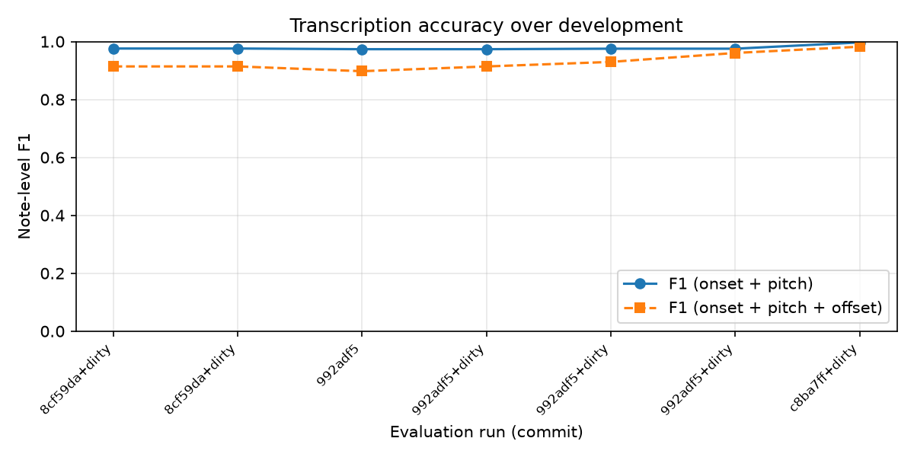

# Piano Transcriber

Convert solo piano recordings into sheet music (MusicXML), built from first principles in Python.

> **Status:** v1 in progress — monophonic transcription. See [DEVLOG.md](DEVLOG.md) for the full development history and [results/](results/) for accuracy over time.

<!-- DEMO: once it works, put a short audio clip link + a screenshot of the generated score here. This is the first thing people see. -->

## What it does

Input: a WAV recording of a single melody line on piano.
Output: a MusicXML file you can open in MuseScore, with pitch, rhythm, tuning and key detected automatically.

## How it works

| Stage | Method | Module |
|---|---|---|
| 1. Load | Mono, resample to 22.05 kHz, normalise | `load.py` |
| 2. Pitch tracking | YIN (implemented from scratch), compared against pYIN | `pitch.py` |
| 3. Tuning estimation | Circular mean of cents offsets | `tuning.py` |
| 4. Onset detection | Spectral flux + adaptive peak picking | `onsets.py` |
| 5. Note segmentation | Onsets + voicing + median pitch per segment | `segment.py` |
| 6. Tempo & quantisation | Inter-onset interval analysis, grid snapping | `rhythm.py` |
| 7. Notation | Key estimation (Krumhansl–Schmuckler), spelling, MusicXML via music21 | `notation.py` |

<!-- Add a figure per stage from figures/ as you go: spectrogram, pitch track, onset function. -->

## Results

Evaluated on synthetic recordings rendered from MIDI (ground truth known) using `mir_eval` note-level metrics.



<!-- Fill in a summary table once you have numbers: test set, precision, recall, F1. -->

## Known limitations

<!-- Be honest here. e.g. monophonic only, assumes steady tempo, struggles with very fast repeated notes. -->

## Roadmap

- [ ] v1: monophonic transcription (modules 1–7)
- [ ] Evaluation harness with automatic logging
- [ ] Test on real recordings of my own playing
- [ ] v2: polyphony (NMF, then pretrained model comparison)
- [ ] v3: smarter notation (hand splitting, tempo tracking) + web app

## Running it

```bash
pip install -r requirements.txt
pip install -e .

# Transcribe a recording
python -m pianotrans.pipeline path/to/recording.wav -o output.musicxml

# Generate synthetic test data (needs FluidSynth + a piano .sf2 soundfont)
python eval/make_test_data.py --soundfont path/to/piano.sf2 --n 20

# Evaluate and log results
python eval/evaluate.py --note "what changed since last run"
```

## Background reading

- M. Müller, *Fundamentals of Music Processing* and the FMP Notebooks
- A. de Cheveigné & H. Kawahara (2002), YIN, a fundamental frequency estimator for speech and music
- J. P. Bello et al. (2005), A Tutorial on Onset Detection in Music Signals
- M. Mauch & S. Dixon (2014), pYIN

## Author

Tim Märtin — Mechanical Engineering, University of Cape Town
