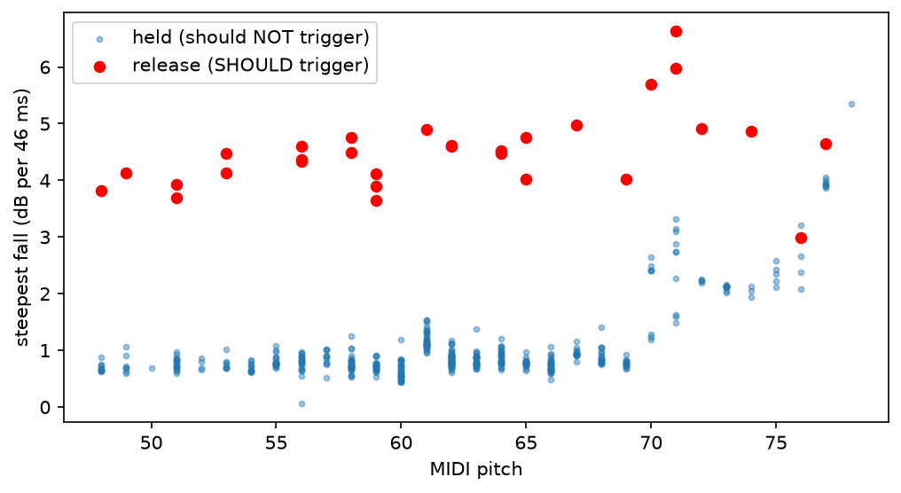

# Piano Transcriber v1: what was built and why

Monophonic piano transcription: a WAV recording of a single melody line in, a list of notes (pitch, start, end) out. Stages 6–7 (rhythm and notation, which produce the sheet music) are still to be built.

**Headline result:** on 30 held-out synthetic melodies (480 notes, GeneralUser GS piano), note-level **F1 = 0.982**, and **0.997** when note endings are ignored. 23 of 30 melodies are transcribed perfectly.

---

## 1. Architecture

```
load_audio ─► track_f0 ─► estimate_tuning ─► f0_to_activation ──┐
         │                                                       ├─► activation_to_notes ─► Notes (seconds)
         ├─► onset_envelope ─► detect_onsets ────────────────────┤
         └─► loudness_db ────────────────────────────────────────┘
```

| File | Role |
|---|---|
| `config.py` | Every shared setting and tuned parameter, in one place |
| `note.py` | `Note(onset, offset, pitch, velocity)`, the object passed between stages |
| `load.py` | Stage 1: audio file → normalised mono signal |
| `pitch.py` | Stage 2: pitch tracking (pYIN) → activation matrix |
| `tuning.py` | Stage 3: global tuning offset in cents |
| `onsets.py` | Stage 4: note attacks (spectral flux + peak picking) |
| `segment.py` | Stage 5: activation + onsets + loudness → discrete notes |
| `pipeline.py` | Wires the stages together; `transcribe()` is what gets scored |
| `eval/make_test_data.py` | Random melodies → MIDI → audio via FluidSynth (ground truth known exactly) |
| `eval/evaluate.py` | Scores the pipeline with `mir_eval`, logs every run to `results/` |

### Design decision 1: one shared frame grid

Every stage uses the same sample rate (`SR = 22050`) and hop length (`HOP = 256`, 11.6 ms per frame), so frame *i* means the same moment in time (*i* × HOP / SR seconds) everywhere. A mismatch between, say, pitch frames and onset frames would break segmentation without any error message.

### Design decision 2: the activation matrix interface

The pitch stage outputs a boolean matrix of shape **(frames × 88 keys)**: `A[i, k]` is True if key *k* sounds in frame *i*. Everything downstream consumes this matrix, never raw frequencies.

- In v1, pYIN gives one pitch per frame, so each row has at most one True.
- In v2 (polyphony), a different estimator (NMF or a neural model) fills several keys per row. **Nothing downstream changes.**

This is the same idea as writing an FEA solver against a generic element interface: the "element" (pitch estimator) can be swapped without rewriting the solver. Segmentation already handles chords, and a unit test checks that.

### Design decision 3: build on libraries, own the engineering

Signal processing primitives come from **librosa** (pYIN, onset strength, RMS, resampling). The project's own contribution is the pipeline design, tuning correction, segmentation logic, release detection, evaluation harness, and every parameter choice, each justified by a measurement.

**Check yourself**
- If `pitch.py` used a hop of 512 but `onsets.py` used 256, what would go wrong in segmentation, and would any test catch it?
- Name one thing the activation matrix *cannot* represent, which a v3 might need.

---

## 2. Stage 1: Loading (`load.py`)

**What it does:** reads the file, averages stereo to mono, resamples to 22,050 Hz, and peak-normalises so the loudest sample is ±1.

**Why each step:**
- **Mono:** pitch doesn't need stereo.
- **22,050 Hz:** half the data of 44.1 kHz. The Nyquist limit becomes ~11 kHz, which is plenty because the highest piano fundamental is 4,186 Hz. librosa low-pass filters before resampling, so there's no aliasing.
- **Normalise:** thresholds (onset sensitivity, loudness) then behave the same for quiet and loud recordings.

**Deliberately not done:**
- **No silence trimming.** That would shift time zero and make every note "late" against ground truth.
- **No noise reduction.** It can soften attacks, which hurts onset detection. Cleaning is a separate, optional step, to be added only if a measurement on noisy data shows it helps.

**What `y` actually is:** the raw pressure waveform, oscillating positive and negative at audio rate. Zoomed out it *looks* like a loudness envelope; zoomed in you can read the period off it (~3.7 ms ≈ 270 Hz for a note near middle C).

**Check yourself**
- Peak normalisation is set by the single loudest sample. What happens to onset detection on a recording containing one loud click?
- Why would MP3 input cause timing errors even if it sounds identical to the WAV?

---

## 3. Stage 2: Pitch tracking (`pitch.py`)

### `track_f0`: pYIN

For each frame (2048 samples ≈ 93 ms window, stepping 11.6 ms), YIN finds the delay at which the signal best matches a shifted copy of itself; that delay is the period. pYIN keeps several candidate periods per frame and picks the most consistent path through time, which reduces octave jumps, and it outputs a **voiced probability**, which is how silence is detected.

**Settings:**
- `fmin = C2`, `fmax = C7`: a narrower search range means fewer octave errors and faster runs.
- `hop_length = HOP`: must match the onset stage.

**Why time-domain (YIN) rather than an FFT:** frequency resolution of an FFT is ~SR/N. Separating the lowest piano notes (1.6 Hz apart) would need a ~0.6 s window, blurring fast notes. YIN measures the period directly and isn't bound by that tradeoff in the same way.

**Octave errors, investigated:** a periodic signal matches itself at delays T, 2T, 3T…, so plain autocorrelation tends to err an octave *low*. YIN counters this by taking the *first* delay that dips below a threshold, which creates the opposite risk: if the 2nd harmonic dominates, the signal nearly repeats every T/2 and YIN reports an octave *high*. Tested on a 110 Hz tone: with the fundamental at 10% of the 2nd harmonic, both YIN and pYIN reported 220 Hz. Piano bass notes have weak fundamentals, so this is where to expect such errors.

### `f0_to_activation`

For each voiced frame: Hz → fractional MIDI number (`m = 69 + 12·log₂(f/440)`), subtract the tuning offset, round to the nearest key, set that cell True.

**Why subtract tuning before rounding:** on a piano 45 cents sharp, an A4 reads as MIDI 69.45. Without correction, any extra sharpness tips it to 70 (A♯4). A unit test checks this exact case.

**Observed behaviour:** frame-level precision ~0.90, recall ~0.99 on a test melody. Recall is high (almost nothing missed); precision is lower because pYIN keeps hearing a pitch through reverb tails. This also showed that repeated notes merge into one run, since the key stays active across the tiny gap. Both observations shaped segmentation.

**Check yourself**
- Why can a held note and a repeated note look identical in the activation matrix? What is the only evidence that distinguishes them?
- If `fmin` were raised to C4, what would happen to a C3 in the melody: would it vanish or become something else?

---

## 4. Stage 3: Tuning (`tuning.py`)

**What it does:** estimates one global offset in cents (positive = sharp of A440) from all voiced frames.

**Why a circular mean:** cents offsets wrap around. +48 and −48 cents are only 4 cents apart (both are about a quarter-tone off, measured from neighbouring keys), but their ordinary average is 0, which wrongly says "in tune". Each offset is treated as an angle (100 cents = one full turn), the angles are averaged as unit vectors, and the result is converted back to cents. A unit test (`test_wraparound`) catches the naive-average mistake.

**Precision limit, measured:** pYIN reports frequencies on a 10-cent grid by default, so the estimate is good to about ±5 cents. Finer resolution is ~50× slower and unnecessary: rounding to the right key needs only ~±40 cents of accuracy.

**Validation** (test melody, detuned in memory):

| True offset | Ours | librosa (independent method) |
|---|---|---|
| 0 | +3.6 | +1.0 |
| +20 | +24.6 | +23.0 |
| −35 | −31.0 | −41.0 |
| +45 | −49.8 | +48.0 |

A consistent ~+4 cent bias (likely the soundfont samples or piano inharmonicity) is harmless.

**Known limitation, the ±50 cent ambiguity:** the +45 case came out as −49.8, which is only ~5 cents away on the circle, so the estimate is fine. But it puts every note **one semitone too high**: a piano 50 cents sharp is indistinguishable from one 50 cents flat of the next key. No algorithm can resolve this from the audio; only a prior ("pianos are usually within ±30 cents") can. Test sets are therefore kept within ±40 cents.

**Check yourself**
- Long held notes contribute more frames to the average than short ones. When could that bias the estimate in a real recording?
- Why does the ±50 cent ambiguity cause a transposition rather than random errors?

---

## 5. Stage 4: Onsets (`onsets.py`)

**What it does:**
1. **Onset envelope (spectral flux):** compare each frame's log-mel spectrum with the previous one and sum only the *increases*. A hammer strike raises energy across many bands at once, giving a sharp spike; a decaying note only loses energy and contributes nothing.
2. **Peak picking:** a frame is an onset if it's a local maximum, at least `delta` above the local average (an adaptive threshold that follows loudness), and at least `wait` frames after the previous onset.

**Why it matters beyond "where notes start":** onsets are the only evidence of repeated notes, and (after the onset gate below) the evidence that a candidate note is real at all.

**Tuning `delta`** (mean onset F1 over 30 melodies, 50 ms tolerance):

| delta | 0.05 | 0.1 | 0.2 | 0.3 | 0.5 |
|---|---|---|---|---|---|
| F1 | 1.000 | 1.000 | 0.994 | 0.947 | 0.629 |

Higher thresholds miss quiet notes. **0.1 was chosen** from the middle of the flat region rather than its edge, leaving margin for noisier real recordings, where low values will produce false onsets. Clean synthetic audio can't show that side of the tradeoff yet.

Detected onsets arrive ~12 ms late (the flux peaks where energy rises fastest, slightly after the attack begins), well within tolerance.

**Check yourself**
- What would the envelope look like during a long decaying note if spectral flux summed absolute changes instead of only increases?
- In this pipeline, which is more harmful: a false onset or a missed one? (Consider what segmentation does with each.)

---

## 6. Stage 5: Segmentation (`segment.py`)

This is where most of the engineering happened. It turns the activation matrix, onsets and loudness into notes, one key at a time.

### Step 1: candidate notes (`active_runs`)
Find runs of consecutive active frames for each key. Trick: pad the column with False, take `np.diff`, and +1 marks run starts while −1 marks run ends.

### Step 2: split repeated notes (`split_at_onsets`)
If an onset falls *inside* a run, cut the run there. This is how two consecutive identical notes are separated.

### Step 3: match each candidate to an onset (onset gate)
Look for the nearest onset within **3 frames before** or **2 frames after** the run's start, and move the start to it. **If there is none, discard the candidate.**

*Why:* every real note starts with a hammer attack. Reverb-tail fragments, semitone flickers in decaying sound, and junk pitches at the bottom of pYIN's range (e.g. C2, D♯2 in melodies that only use C3–C6) don't.

*Why two-sided:* the first version only searched *before* the run's start and lost 12% of real notes. pYIN's 93 ms window "sees" a note slightly early, while detected onsets arrive ~12 ms late, so the onset often sits just *after* the pitch starts. Allowing 2 frames (23 ms) after fixed it completely.

### Step 4: end notes at the key release (`find_release`)
Without this, a note ends when pYIN stops hearing a pitch, which includes the reverb tail. Every final note ran to the end of the file (~1 s late).

**First attempt: a loudness level** ("end when 30 dB below the note's peak") gave only a small gain, because levels overlap: held notes can sag up to 26 dB, while released notes can still be only ~20 dB down 200 ms later.

**Second attempt: loudness slope.** A held string fades slowly; when the key is released the damper stops it fast. Measured on the GeneralUser test set:



- Below ~MIDI 70: held notes never fall faster than ~1.6 dB per 46 ms; releases fall ≥ 3.5. Cleanly separable.
- Above ~MIDI 70: held notes fade much faster (2–3.5 dB, up to 6), overlapping releases. The jump is abrupt, suggesting the soundfont switches sample sets there (partly physics, partly this instrument).

A fixed slope threshold tuned on a different soundfont (FluidR3) failed on this one: too strict for mid-range notes (releases never detected) and too loose for high notes (cut mid-note).

**Final rule: slope relative to the note's own fade.** A release is the first frame (after the attack) where loudness falls more than `RELEASE_SLOPE_DB = 3.0` dB over the next 4 frames **and** more than `RELEASE_RATIO = 1.5` times faster than over the previous 4 frames. Fast-fading high notes don't trigger it; a damper cutting in does, at any pitch.

Parameter sweep on `data/tune` (full F1):

| slope \ ratio | 1.5 | 2 | 3 |
|---|---|---|---|
| 2 | 0.911 | 0.947 | 0.912 |
| 2.5 | 0.941 | 0.945 | 0.904 |
| **3** | **0.949** | 0.937 | 0.899 |
| 3.5 | 0.951 | 0.916 | 0.897 |
| 4 | 0.930 | 0.910 | 0.897 |

The good settings form a diagonal ridge (both parameters are "falling fast enough?" thresholds, so loosening one compensates for tightening the other). **(3, 1.5)** was chosen over the top score (3.5, 1.5) because all its neighbours are ≥ 0.937, whereas (3.5, 1.5) sits next to a cliff. 0.897 is the "never fires" baseline.

### Step 5: drop blips
Anything shorter than 50 ms is removed.

**Check yourself**
- Why can't a fixed loudness *level* separate held from released notes, while the *rate* of fall can? Explain physically.
- The onset gate is what made the attack-pitch glitches disappear. Why would a 100 ms burst of the wrong pitch at the start of a note now be discarded?
- Segmentation works per key. What would break if two different keys were active in the same frame (v2) and you used the "majority pitch between onsets" approach instead?

---

## 7. Evaluation methodology

### Synthetic ground truth (`make_test_data.py`)
Random-walk melodies in a major scale (MIDI 48–84, random tempo 70–140 BPM, random velocity), written as MIDI and rendered to audio with FluidSynth using the GeneralUser GS soundfont. The MIDI is the exact answer key.

Quirks of this data that showed up in results:
- Each note lasts 90% of its slot (a small gap before the next).
- FluidSynth adds reverb, and `pretty_midi` renders 1 s after the last note-off, so tails ring past note-off.

### Metrics (`mir_eval.transcription`)
- **Onset-only F1:** a note counts as correct if the pitch matches and the onset is within 50 ms.
- **Full F1:** additionally, the offset must be within 20% of the note's duration or 50 ms, whichever is larger. For short notes the 50 ms floor applies, which is why short notes ending ~50 ms late still fail.

### Tune / test split
Parameters were chosen on `data/tune` (seed 0) and reported on `data/test` (seed 1, never used for tuning). Release detection scored 0.949 on tune and 0.961 on test, so there's no sign of overfitting.

### Logging
Every `evaluate.py` run appends date, git commit, a note on what changed, and scores to `results/results.csv` and redraws `results/progress.png`.

### Error analysis
Notebook `04-error-analysis` lists every missed note, extra note and offset error per file, with a `TOTAL` breakdown. Each fix was chosen by looking at which error category dominated.

### Fast parameter sweeps
pYIN is slow (~8 min for 30 files), but the release and onset-matching parameters only affect segmentation. Caching pYIN output, onsets and loudness once, then rerunning segmentation alone, cut a 15-setting sweep from about 2 hours to seconds.

**Check yourself**
- Why is a score measured on the same files you tuned on optimistic, even if you only chose two numbers?
- Your synthetic set is now nearly solved. What would a harder test set need, to expose the next weaknesses?

---

## 8. Results timeline

| Step | Data | Full F1 | Onset-only F1 | Main remaining errors |
|---|---|---|---|---|
| First end-to-end run | 5 files | 0.914 | 0.976 | Last note ~1 s late in every file |
| Baseline (no release detection) | 30 held-out | 0.901 | 0.975 | Offsets 37, extras 22, missed 5 |
| + release detection (slope 3, ratio 1.5) | 30 held-out | 0.961 | 0.975 | Extras 23, offsets 7, missed 2 |
| + onset gate, two-sided matching | 30 held-out | **0.982** | **0.997** | 7 files with 1–3 errors |

### Remaining errors
| Files | Error | Cause |
|---|---|---|
| 013, 014, 023 | Short notes end ~50 ms late | Run into the next note; partly the generator's fixed 10% gap |
| 011 | Last note (E5) ends late | Release not detected on a high note |
| 008 | One repeated D4 missed | Onset not detected between the two notes |
| 012, 024 | One onset-level error each | Not yet investigated |

---

## 9. Known limitations
- **Monophonic only:** one pitch per frame (the interface is ready for v2).
- **Tuning near ±50 cents** can transpose everything by a semitone.
- **No sustain pedal:** with the pedal down, melody notes overlap in the audio, which breaks the one-pitch-per-frame assumption.
- **Release detection was tuned on one synthetic piano.** Real pianos and rooms will need re-measuring with the slope-vs-pitch plot.
- **Onset `delta` was tuned on clean audio** and may produce false onsets on noisy recordings.
- **Bass notes** have weak fundamentals, so expect octave-high errors there.

---

## 10. Lessons learned (process)
- **Measure the data, don't guess.** The release threshold came from a plot of held vs released slopes, not intuition, and the plot showed why the first threshold failed.
- **Parameters don't transfer between datasets.** A threshold tuned on FluidR3 failed on GeneralUser. Report which data a result came from.
- **Keep one source of truth for each setting.** A default defined in two places (`activation_to_notes` silently overrode `find_release`) meant `evaluate.py` ran a different setting from the notebook. It was caught only because the same number was computed two ways.
- **Check you're measuring the right data.** A cached result was briefly computed on the tuning set instead of the test set; a mismatched number exposed it.
- **Environment hygiene.** Two virtual environments both named `.venv` meant the terminal and notebooks used different packages. Fix: distinct prompt names (`piano`, `fmp`).
- **Don't name a module after the standard library.** `types.py` shadowed Python's built-in `types` module; renamed to `note.py`.
- **Prefer the middle of a plateau** over the single best score when choosing parameters (onset delta 0.1; release (3, 1.5)).

---

## Next: stages 6–7
- **Rhythm:** estimate tempo, convert seconds to beats, snap to a sixteenth-note grid.
- **Notation:** estimate the key, spell notes correctly, split notes into bars with ties, write MusicXML, and open it in MuseScore.
